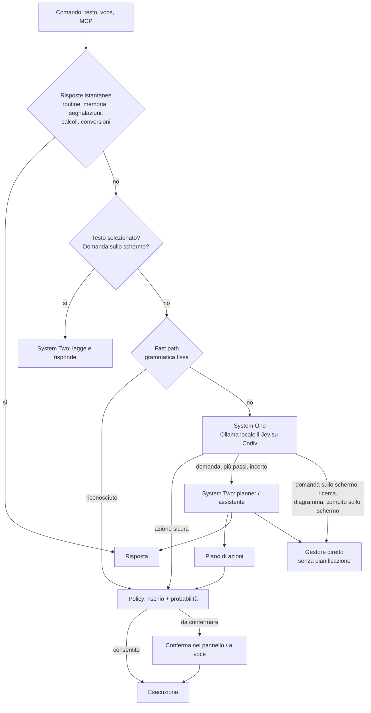

# Come decide RedOS: System One, System Two, Ollama e Codiv

Stato: v0.14 (12/10/2026). Misure e dettagli di sviluppo in [PLAN.md](PLAN.md).

## In breve

RedOS divide il lavoro come i due "sistemi" di Kahneman:

- **System One** sono i riflessi: capisce in meno di un secondo cosa vuoi, sceglie un'azione dal catalogo e
  ne estrae i parametri. Gira **sul Mac** (Ollama) e, se configurato, insieme a **Jev su Codiv**.
- **System Two** è il ragionamento: risponde alle domande, pianifica i compiti in più passi, guida l'agente
  sullo schermo, cerca sul web, disegna diagrammi. Usa il **provider scelto** (Copilot, OpenAI, Claude,
  Gemini) oppure Ollama.

Quasi tutti i comandi brevi ("apri Safari", "volume a 30") si fermano a System One. Solo ciò che richiede di
ragionare passa a System Two, che è più lento (1–3 s) e, se cloud, ha un costo.

| Pezzo | Cos'è | Dove gira | Serve rete | Obbligatorio |
|---|---|---|---|---|
| **Ollama** | runtime per modelli locali | Mac | no | sì (System One locale) |
| **System One locale** | `gemma4:e4b-it-qat` sceglie l'azione, `gemma4:e2b-it-qat` estrae i parametri | Ollama | no | sì |
| **Jev su Codiv** | OpenJev (DiffusionGemma 26B) che riconosce il *tipo* di richiesta e l'azione | cloud `api.codiv.ai` | sì | no (Impostazioni > Modelli > Decisioni rapide) |
| **System Two** | modello "grande" per risposte, piani, agente, ricerca, diagrammi | provider scelto, o Ollama | se cloud | sì (anche solo Ollama) |

## Il percorso di un comando

In ordine (`CommandEngine.resolve`):

1. **Risposte istantanee, senza modello**: routine ("avvia la routine buongiorno"), memoria ("ricorda che…"),
   segnalazioni, calcoli ("20% di 150"), conversioni ("10 miglia in km").
2. **Contesto speciale**: richieste sul testo selezionato ("traduci il testo selezionato") e domande sullo
   schermo ("di cosa parla questa pagina?") vanno subito a System Two con il contenuto come dato. Lo stesso
   vale per le frasi che citano fatti ricordati ("apri il mio editor").
3. **Fast path**: grammatica deterministica, circa 0 ms ("apri Safari", "scrivi ciao", "scorri giù 10",
   "clicca qui", "apri github.com con Chrome", "avvia il comando rapido Casa"). Copre anche sequenze semplici
   ("apri Mail e scrivi ciao").
4. **System One** (sotto): sceglie un'azione, oppure dice "nessuna" o "più passi".
5. **System Two** (sotto) se System One non è sicuro o la richiesta non è una singola azione.
6. **Policy**: decide se eseguire subito o chiedere conferma.

## System One

### Locale (Ollama), sempre attivo

1. **Scelta dell'azione**: al modello `gemma4:e4b-it-qat` arriva il catalogo come menu a lettere
   (`A) app.open: …`, `B) app.quit: …`, …, oltre la Z si prosegue con a–z, più "più passi" e "nessuna"), con una
   cinquantina di esempi
   it/en. Il modello genera **un solo token** e RedOS legge le **probabilità vere** delle lettere dai logprob
   di Ollama (`OllamaSystemOne`): non si chiede al modello quanto è sicuro, lo si misura.
   Il prompt di sistema non cambia tra un comando e l'altro, quindi Ollama lo tiene in cache: circa 0.25 s.
2. **Parametri**: un secondo modello più piccolo, `gemma4:e2b-it-qat`, estrae gli argomenti in JSON (~0.5 s),
   proseguendo la stessa conversazione per riusare la cache (`ArgumentExtractor`). I numeri che l'utente
   non ha detto vengono scartati: niente coordinate inventate.
3. **Correzioni** (`SystemOneRouter.refine`): "scrivi X nel campo di testo" diventa testo nel campo attivo;
   "premi il secondo menu" e i parametri mancanti passano a System Two invece di fallire.
4. **Soglia**: sotto la probabilità minima (0.5; con Priorità *Precisione* almeno 0.85) la richiesta non viene
   eseguita ma passa a System Two con l'azione come suggerimento.

Misure (`make eval`, 105 comandi it/en): decisione come la prende l'app **94.3%**, p50 0.67 s compresi i
parametri.

### Jev su Codiv, opzionale

[Jev](https://codiv.ai) è un protocollo per modelli "System One": domande tipizzate (scelta fra opzioni,
numero, punteggio) con risposte e probabilità in un solo passaggio. RedOS usa **OpenJev** ospitato da
**Codiv** (`https://api.codiv.ai`, modello `openjev-latest`, chiave nel Portachiavi).

In una richiesta (`JevIntentRouter`) RedOS fa due domande sul comando:

- **tipo**: azione, più passi, compito sullo schermo, domanda sullo schermo, conoscenza, informazione attuale,
  diagramma;
- **azione**: quale voce del catalogo (incluse le azioni dei server MCP).

Locale e Jev partono **in parallelo** (`HybridRouter`):

| Caso | Chi vince |
|---|---|
| Il modello locale sceglie un'azione con sicurezza | il locale, subito (~0.25 s). Eccezione: se entro 0.7 s Jev dice con ≥ 90% che è una domanda sullo schermo, una ricerca o un diagramma, vince Jev ("di cosa parla questa finestra?" non diventa "leggi lo schermo") |
| Il locale non è sicuro, o dice "nessuna" / "più passi" | il **tipo** di Jev: domande sullo schermo, ricerche, diagrammi e compiti sullo schermo partono subito, **senza** la chiamata di pianificazione a System Two (si risparmiano 1–3 s) |
| Jev sceglie un'azione che il locale non ha scelto con sicurezza | System Two decide (da solo Jev eseguiva 4 azioni sbagliate su 89) |
| Rete assente, "Solo offline", nessuna chiave | solo il locale, come se Jev non ci fosse |

Perché entrambi: il locale è più veloce e più preciso sulle singole azioni (92% contro 89%, nessuna azione
sbagliata eseguita); Jev riconosce il tipo di richiesta molto meglio (43/43 in `eval/intents.jsonl`). Il
modello Jev impiega 26–145 ms; dall'Italia la richiesta completa è ~0.7–0.8 s, quasi tutta rete.

A Codiv arriva solo il testo del comando ("User request: …") con le opzioni del catalogo, nient'altro.

## System Two

Un unico provider, scelto in Impostazioni > Modelli, svolge più ruoli:

| Ruolo | Quando | Client usato |
|---|---|---|
| **Assistente** | domande, richieste che System One non capisce o non è sicuro | provider |
| **Planner** | richieste in più passi ("apri il progetto, fai pull e lancia i test") → piano di azioni validate | provider con *Precisione*, Ollama con *Velocità* |
| **Agente sullo schermo** | compiti che richiedono di guardare lo schermo a ogni passo ("compila il modulo"); con Jev il primo clic e il "finito" li decide Jev (~0.8 s invece di 3–5 s) | come il planner |
| **Lettore** | testo selezionato, domande sullo schermo | provider |
| **Ricerca web** | informazioni attuali (meteo, notizie, cambi, "chi ha diretto…") | provider + strumenti web |
| **Diagrammi** | "disegna l'architettura…" | provider (con *Velocità* ragiona meno) |
| **Appunti delle call** | appunti live ogni ~minuto di conversazione e minuta finale ("prendi appunti") | provider |

Il planner restituisce una sola struttura JSON: un **piano** (azioni), una **risposta** testuale, oppure
"guarda lo schermo", "serve l'agente", "cerca sul web: query", "disegna: descrizione". Le azioni proposte
vengono **validate** sul catalogo prima di qualsiasi esecuzione.

Provider disponibili:

| Provider | Note |
|---|---|
| Ollama | locale e gratuito; più lento e meno preciso sui compiti difficili |
| GitHub Copilot | abbonamento Copilot; un processo `copilot --acp` sempre aperto, ~1–2 s per chiamata, strumenti disattivati |
| OpenAI / Anthropic / Gemini | chiave API nel Portachiavi |

Protezioni per i provider cloud:

- **Limite giornaliero** (Privacy & Cloud): oltre il numero di richieste impostato si passa al modello locale.
- **Solo offline**: System Two usa Ollama qualunque sia il provider, e Jev viene escluso.

## Correzioni mentre lavora

Mentre RedOS esegue una richiesta fatta a voce, il microfono resta aperto (con cancellazione d'eco). Quello che
dici viene classificato: prima da regole ("fermati", "no, …", "e poi …"), poi da System One (Jev se c'è,
altrimenti il modello locale) con quattro opzioni:

| Tipo | Esempio | Cosa succede |
|---|---|---|
| stop | "fermati", "lascia stare" | il lavoro si interrompe |
| modifica | "no, a Luca", "usa Chrome" | il lavoro si interrompe e System Two ripianifica sapendo cosa era già partito |
| aggiunta | "e poi apri Slack" | eseguita da System Two quando il lavoro finisce |
| non per RedOS | "Marco, ti richiamo dopo" | ignorato, il lavoro continua |

## Ollama: cosa ci gira

| Modello | Uso | Sempre |
|---|---|---|
| `gemma4:e4b-it-qat` (~6 GB) | scelta dell'azione (System One); System Two quando il provider è Ollama, offline, oltre il limite giornaliero, o planner/agente con Priorità *Velocità* | sì |
| `gemma4:e2b-it-qat` (~4 GB) | estrazione dei parametri | sì |

Senza Ollama attivo: se Jev è configurato decide Jev, altrimenti RedOS capisce solo fast path e risposte
istantanee. Settings > Setup lo segnala e lo avvia.

## Policy: quando chiede conferma

Ogni azione ha un rischio: *safe* (aprire app, volume), *moderate* (scrivere testo, premere pulsanti, chiudere
app, bozza mail), *dangerous* (comandi di shell).

- *dangerous*: sempre confermata.
- *moderate* scelta da un modello con probabilità sotto 0.85: confermata.
- Piani scritti da System Two: confermati se contengono anche un solo passo oltre *safe*.
- Fast path e routine avviate da te: eseguite subito (tranne *dangerous*). Routine avviate da un trigger:
  confermate se hanno passi oltre *safe*.

## Esempi

| Comando | Chi decide | Cosa succede | Tempo tipico |
|---|---|---|---|
| "apri Safari" | fast path | apre l'app | istantaneo |
| "20% di 150" | calcolatrice | risposta | istantaneo |
| "abbassa un po' l'audio" | System One locale | `volume.set` | ~0.7 s |
| "metti il tema scuro" | System One locale | `appearance.set` | ~0.7 s |
| "di cosa parla questa pagina?" | regola "domanda sullo schermo" | legge la finestra, System Two risponde | 2–5 s |
| "che tempo fa domani a Milano?" | Jev (informazione attuale) o System Two | ricerca web + grafico | 5–10 s |
| "chi ha scritto i Promessi Sposi?" | System Two (assistente) | risposta | ~2 s |
| "apri il progetto, fai pull e lancia i test" | Jev "più passi" → planner (senza Jev il locale può scambiarla per un comando di shell, che va comunque confermato) | piano, conferma | 2–3 s + conferma |
| "compila il modulo di iscrizione" | Jev (compito sullo schermo) o planner | agente sullo schermo | 10–60 s |
| "disegna l'architettura di RedOS" | Jev (diagramma) o planner | diagramma in finestra | 40–90 s |
| "e a Roma?" (dopo il meteo) | System Two con la conversazione recente | meteo di Roma | 5–10 s |

## Configurazioni tipiche

| Configurazione | System One | System Two | Cosa esce dal Mac |
|---|---|---|---|
| **Tutto locale** (Solo offline) | Ollama | Ollama | nulla, tranne le ricerche web esplicite |
| **Locale + Copilot** (consigliata se hai Copilot) | Ollama | Copilot | richieste a System Two |
| **Locale + Codiv + cloud** | Ollama ‖ Jev | provider | testo dei comandi a Codiv; richieste a System Two |

## Dati inviati

- **Codiv**: il testo del comando e le opzioni del catalogo.
- **Provider di System Two**: la persona e le regole dette a voce, la richiesta, il titolo della finestra in
  primo piano, i fatti ricordati, gli
  ultimi scambi della conversazione e, per le domande sullo schermo o sul testo selezionato, quel contenuto.
  Durante gli appunti, la trascrizione della call (non l'audio).
  Alla ricerca web non vengono passati i fatti ricordati.
- **Mai**: chiavi API, audio (riconoscimento vocale e wake word sono sul Mac).

## Limiti noti

- **Catalogo locale**: ogni opzione del System One locale è un solo carattere (A–Z, poi a–z), quindi al
  massimo 52. Oggi sono 25 (23 azioni + "più passi" + "nessuna"). Le azioni dei server MCP vanno solo a Jev e
  a System Two.
- **Più passi in locale**: senza Jev, alcune richieste in più passi vengono scambiate per una singola azione;
  in quel caso RedOS chiede comunque conferma.
- **Jev**: ~0.7 s dall'Italia, quasi tutto rete; per questo il locale resta in prima linea sulle singole azioni.

## Dove sta il codice

| Parte | File |
|---|---|
| Percorso del comando | `Sources/RedOSCore/Commands/CommandEngine.swift`, `CommandEngine+Extras.swift`, `CommandEngine+Screen.swift` |
| Fast path | `Sources/RedOSCore/Commands/FastPathParser.swift` |
| System One locale | `Sources/RedOSCore/SystemOne/SystemOneRouter.swift`, `OllamaSystemOne.swift`, `ArgumentExtractor.swift` |
| Jev / Codiv | `Sources/RedOSCore/SystemOne/JevIntentRouter.swift`, `JevHTTPSystemOne.swift`, `HybridRouter.swift` |
| System Two | `Sources/RedOSCore/SystemTwo/` (planner, provider, Copilot ACP, limite giornaliero) |
| Agente, ricerca, diagrammi | `Sources/RedOSCore/Agent/`, `Research/`, `Diagrams/` |
| Policy | `Sources/RedOSCore/Policy/Policy.swift` |
| Configurazione dei modelli | `Sources/RedOS/AppController.swift` (`rebuildEngine`, `makeRouter`) |
| Misure | `make eval` (System One locale), `make eval-jev` (Jev) |
